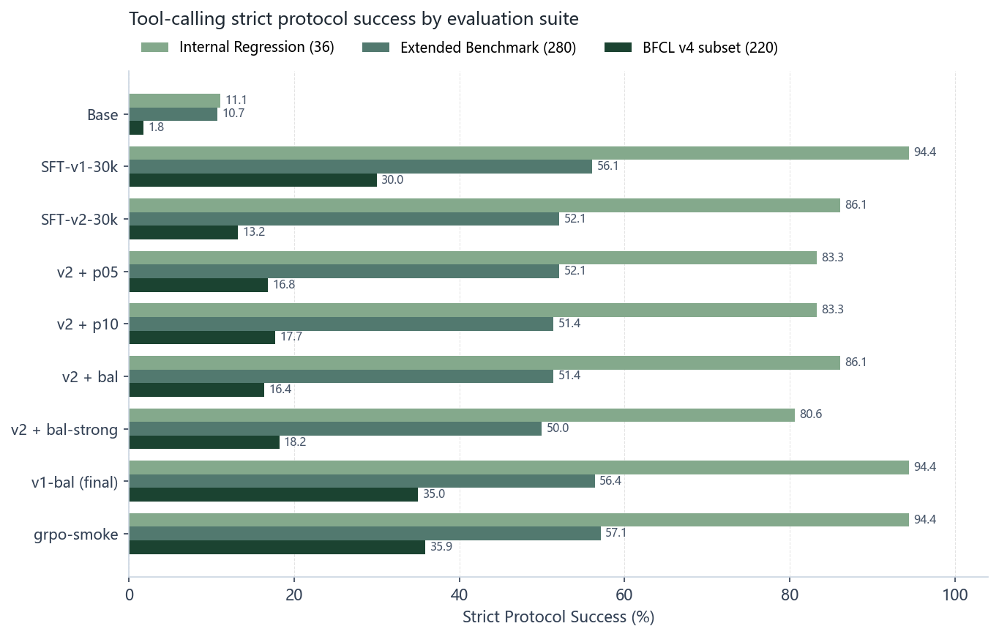
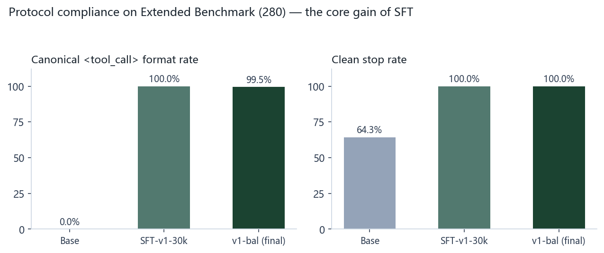
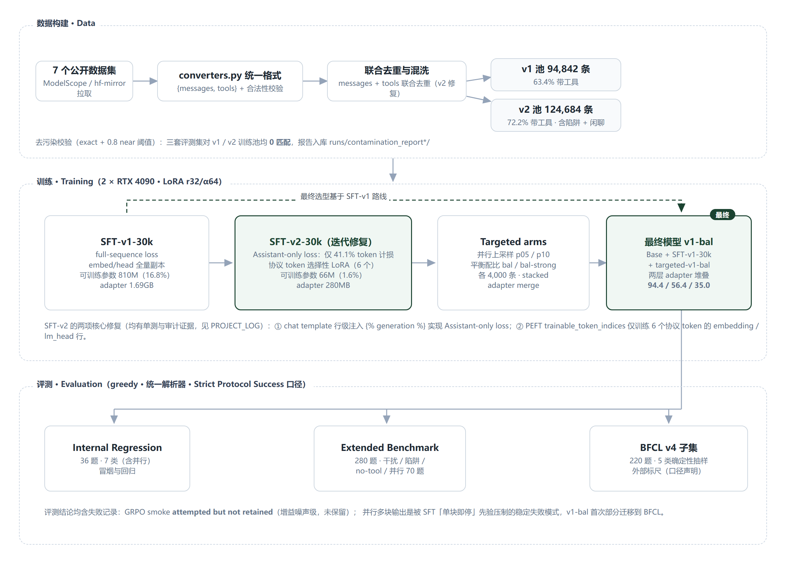

# Qwen3-4B 工具调用 SFT（双 RTX 4090 可复现实验）

在单节点 2 × RTX 4090（24GB）上，用 LoRA 对 **Qwen/Qwen3-4B-Base** 做工具调用
（Function / Tool Calling）监督微调：两代 SFT、Assistant-only loss、
**选择性特殊 token LoRA（可训练参数 810M → 66M）**、12.5 万条数据池
（联合去重 + 基准去污染）、三套评测集（36 / 280 / 220，含 BFCL v4 子集）——
每个数字可复现，每次失败有记录。

[English](README.md) | 简体中文

[](https://www.python.org/)
[](LICENSE)
[](https://github.com/alinj4253-droid/qwen-tool-calling-sft/actions/workflows/ci.yml)

## 主结果（Strict Protocol Success，%）

| 模型 | Regression (36) | Extended (280) | BFCL v4 子集 (220) |
|---|---:|---:|---:|
| Base | 11.1 | 10.7 | **1.8** |
| SFT-v1-30k | 94.4 | 56.1 | 30.0 |
| SFT-v2-30k | 86.1 | 52.1 | 13.2 |
| p05（v2+5% 并行） | 83.3 | 52.1 | 16.8 |
| p10（v2+10% 并行） | 83.3 | 51.4 | 17.7 |
| bal（v2+平衡） | 86.1 | 51.4 | 16.4 |
| bal-strong（lr1e-4/3ep） | 80.6 | 50.0 | 18.2 |
| **v1-bal（最终）** | **94.4** | **56.4** | **35.0** |
| grpo-smoke（未保留） | 94.4 | 57.1 | 35.9 |

- **规范 `<tool_call>` 格式率 0% → 100%**：SFT 的核心增益是协议合规。
- 最终模型 = Base + SFT-v1-30k LoRA + targeted-v1-bal LoRA 两层堆叠。
- 括号口径：Base 在三套评测的 overall 任务正确率分别为 91.7 / 67.1 / 63.2。

<p align="center">
  
</p>
<p align="center">
  
</p>

**Strict Protocol Success 定义**：任务正确（工具选择 + 参数精确匹配、无多余/缺失）
且所有调用来自原生 `<tool_call>` 块、以 `<|im_end|>`/eos 干净停止；
裸 JSON 即使内容正确也不计 Strict（单独以 overall / canonical / clean-stop 列示）。
所有数字来自仓库内 `runs/eval_*/metrics.json`。

## 实验流水线

<p align="center">
  
</p>

1. **数据**：7 个公开数据集经 `converters.py` 统一为 `{messages, tools}` 格式，
   合法性校验、**messages+tools 联合去重**（v1 只看 messages 的 bug 已在 v2 修复）、
   混洗切分：v1 池 94,842 / v2 池 124,684（72.2% 带工具，含陷阱样例与纯闲聊）。
   去污染校验（exact + 0.8 near 阈值）对两个训练池均 **0 匹配**。
2. **SFT-v1**：full-sequence loss + embed/head 全量 `modules_to_save`，
   可训练参数 810,942,464（16.78%），adapter 1.69GB。
3. **SFT-v2（两次关键修复，均有单测与审计证据，见 [PROJECT_LOG.md](PROJECT_LOG.md) 第 13–17 节）**：
   - **Assistant-only loss**：chat template 行级注入 `…`
     （8 场景渲染与原模板逐字节一致），自研 `ChunkedNLLSFTTrainer`（ce_chunk=256）
     只对 assistant token 计 NLL——72.5M 总 token 中 29.8M（41.1%）被监督；
   - **选择性特殊 token LoRA**：PEFT `trainable_token_indices=[151644,151645,151657,151658,151665,151666]`
     只训练 6 个协议 token（im_start/im_end、tool_call/tool_response 开闭）的
     embedding/lm_head 行——可训练参数降至 **66,075,648（1.6161%）**，adapter **280.3MB**，
     v1 的故障 token「𬜯」（id 122588）消失。
4. **Targeted arms**：并行上采样（p05/p10）与平衡配比（bal/bal-strong），各 4,000 条、
   确定性 seed，以 stacked adapter merge 挂在基础 SFT adapter 之上。
5. **评测**：内部回归（36）· 扩展基准（280：single / multiple / parallel-same(50) /
   parallel-diff(20) / multi-arg / distractor / wrong-tool-trap / no-tool）·
   BFCL v4 子集（220，确定性抽样——**不与官方 BFCL 榜单可比**）。
   全部 greedy、max_new_tokens=1024、统一解析器。

## 诚实结论

- **SFT 的主要增益是协议合规而非任务能力**：规范格式 0%→100%，干净停止约 64–70%→100%。
- **并行多块调用是稳定失败模式**：v1/v2 及 4 个 targeted arm 在 Extended 100 个多调用题上
  全为 0；基座本可用裸 JSON 完成多调用（BFCL 同名/异名任务正确率 64% / 73.3%），
  能力在基座、被 SFT「单块即停」先验压制；v1-bal 首次把规范多块输出部分迁移到 BFCL
  （同名 2%→20%、异名 0%→6.7%），但未泛化到自然语言并行。
- **v2 引入过度调用回归**：陷阱拒答 80.8%→3.8%、BFCL 拒答 90%→10%；
  v1 路线的拒答能力始终保持——这正是最终选型 v1-bal 的原因。
- **GRPO smoke：attempted but not retained**。80 prompt × 30 步 × 5 个可解释奖励
  相对 v1-bal 仅 +0.7/+0.9pp（噪声级）且出现 1 例非规范输出，未达保留门槛；
  脚本与配置保留用于复现该结论，最终模型继续使用 SFT。

以上每条结论都有入库证据：`runs/eval_*/metrics.json`、`runs/eval_*/predictions.jsonl`、
`runs/comparison_*.md`、append-only 的 [PROJECT_LOG.md](PROJECT_LOG.md)（完整失败→修复链）。
最终选型的 28 个必答问题见 [FINAL_DECISION.md](FINAL_DECISION.md)。

## 仓库结构

```
configs/        全部 YAML：数据 / 训练 / 评测 / accelerate / RL
scripts/        下载 / 数据 / 训练 / 评测 / 去污染 / GRPO smoke 入口
src/qwen_tool_sft/   路径守卫、转换、解析、指标、loss mask、去污染
eval/           36 + 280 + 220 题集 + BFCL manifest
runs/           adapter 元数据、metrics.json、predictions.jsonl（权重不入库）
tests/          pytest（路径守卫 / 模板 mask / 去重 / 去污染 / Strict 指标 / 并行评测…）
docs/images/    图表与流水线图（由真实 runs/ 数据生成）
```

## 复现

硬件：2 × RTX 4090（24GB）；独立 conda 环境 `qwen_tool_sft`（Python 3.11.16）。
关键版本见 `requirements.lock.txt`：torch 2.14.0+cu130、transformers 4.57.6（刻意 <5）、
trl 1.13.0、peft 0.21.0。HuggingFace 直连不通的环境：模型走 ModelScope、数据集走
hf-mirror（`scripts/env.sh` 固定 `HF_ENDPOINT`）。

```bash
source scripts/env.sh

# 1. 模型与数据
python scripts/download_model.py --model Qwen/Qwen3-4B-Base
python scripts/fetch_datasets.py
python scripts/prepare_data.py --config configs/data_full.yaml      # v1 池
python scripts/prepare_data.py --config configs/data_full_v2.yaml   # v2 池

# 2. 双卡 SFT
accelerate launch --config_file configs/accelerate_dual4090.yaml scripts/train.py \
  --config configs/train_sft_30k.yaml          # v1
accelerate launch --config_file configs/accelerate_dual4090.yaml scripts/train.py \
  --config configs/train_sft_v2_30k.yaml       # v2

# 3. targeted 数据（示例：平衡池）
python scripts/build_balanced_data.py --src data/full_v2/train.jsonl \
  --out data/targeted_bal --total 4000 --parallel-fraction 0.10 --trap-fraction 0.10 --chat-fraction 0.10 --seed 42

# 4. 评测
CUDA_VISIBLE_DEVICES=0 python scripts/evaluate.py --config configs/eval_targeted_v1_bal_benchmark.yaml
python scripts/rescore_predictions.py runs/eval_xxx   # 离线重打分，无需 GPU

# 5. 去污染（评测集构建后必做）
python scripts/check_contamination.py --train data/full_v2/train.jsonl \
  --benchmark eval/bfcl_subset.jsonl --out runs/contamination_report/bfcl_subset --threshold 0.8
```

测试（无需 GPU / 模型 / Key——CI 即此配置）：

```bash
PYTHONPATH=src python -m pytest -q        # 重型 torch 用例在缺依赖时自动 skip
python -m compileall -q src scripts tests
```

SFT-v2-30k 实测：1,875 步 / 6,916.9s（115.3 分钟），train_loss 0.2576，
峰值显存 rank0 17.68/21.08GB。

## 安全与隐私

- 所有写入限制在项目目录内（`src/qwen_tool_sft/paths.py` 对越界路径直接报错）；
  仓库不含 SSH 密码、Token、私钥、内网地址，推送前对全部 git 历史做过密钥特征扫描，
  见 [PRIVACY.md](PRIVACY.md)。
- 评测样例均为虚构天气 / 股票 / 邮件场景。

## 许可与归属

- 自有代码 MIT（[LICENSE](LICENSE)）；上游参考 FuzzyFade/qwen35-tool-calling-sft
  （无 LICENSE）仅本地参考、不随仓库重新分发（`upstream-src/UPSTREAM_VERSION.txt`）。
- 模型 Qwen/Qwen3-4B-Base（Apache-2.0）；数据集与 BFCL/Gorilla 归属见
  [THIRD_PARTY_NOTICES.md](THIRD_PARTY_NOTICES.md)。

英文说明见 [README.md](README.md) · 简历可用指标 [RESUME_METRICS.md](RESUME_METRICS.md)
